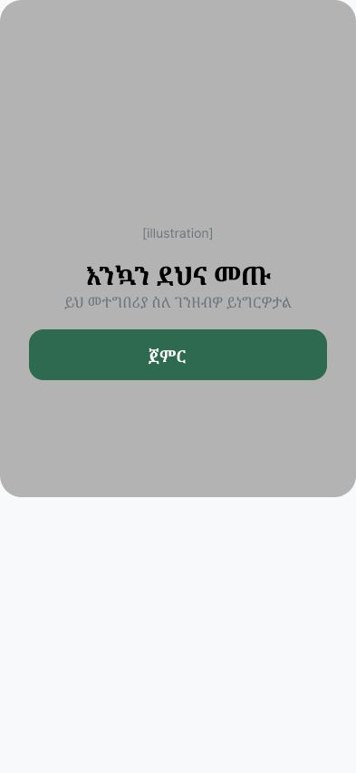
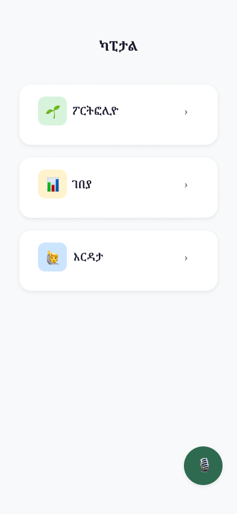
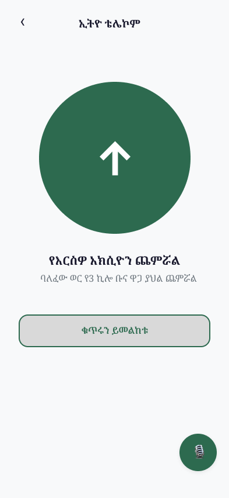
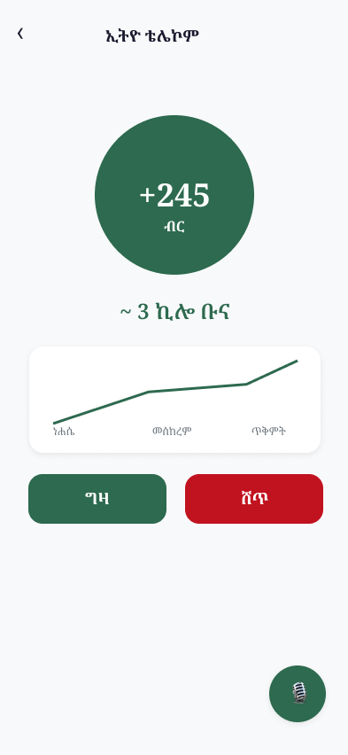
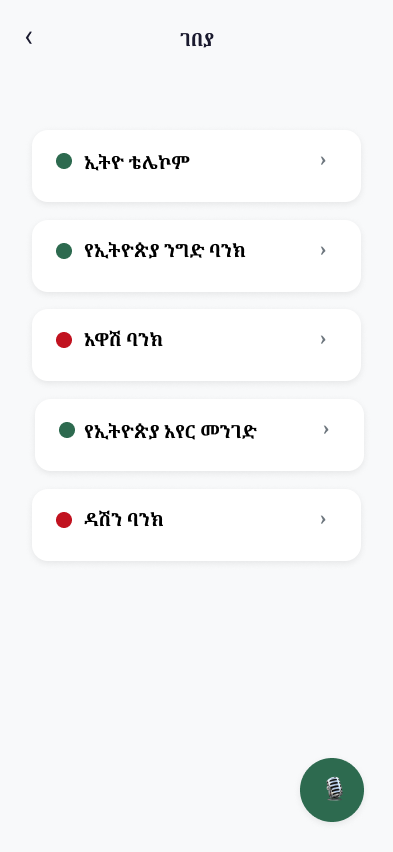
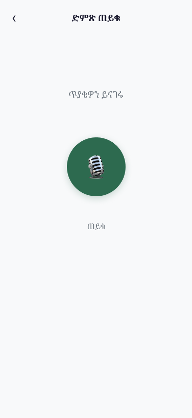

# Ethiopian Fintech HCI — Low-Literacy Financial Interface Research

## Research Questions

1. Can low-literacy Ethiopian users understand whether their investment
went up or down using icon and color-based display, without numerical labels?

2. Does presenting financial values in locally meaningful units
(bags of teff,daily taxi fees) improve comprehension compared
to birr amounts alone?

3. Does voice query interaction reduce task abandonment compared to
text navigation for users with low digital literacy?

## Why This Matters

Ethiopia's capital markets are expanding, but the interfaces built
to serve them assume users who are financially literate, comfortable
with numerical displays, and reading in a second language.The primary design challenge was not technical but communicative: how do you make financial information legible to the people it is
supposed to serve?

This prototype investigates what a genuinely inclusive financial
interface looks like when designed from the ground up for low-literacy
Ethiopian users, rather than adapted downward from a Western fintech template.

## Prototype

Interactive Figma prototype: [link — coming once prototype is complete]

Screenshots:
## Screens

| Onboarding | Home | Portfolio Overview |
|------------|------|-------------------|
|  |  |  |

| Portfolio Detail | Market | Voice Query |
|-----------------|--------|-------------|
|  |  |  |

## Study Design

A usability study with 8 participants across four literacy levels
will test each research question using a think-aloud protocol and
five standardized tasks. Full methodology: /study/methodology.md

## Current Status

- ✅ Literature review complete
- ✅ Design rationale complete
- ⏳ Prototype complete
- ⏳ Study methodology designed
- ⏳ Usability study pending institutional affiliation and ethics review

## Why Institutional Support Is Required

The usability study requires IRB ethics review, structured participant
compensation, and methodological supervision that responsible research
demands. This project is designed to be executed within a graduate
research environment. The prototype and methodology represent the
preparatory work completed independently before that support is available.

## Limitations

This prototype was designed without institutional affiliation. The
study methodology is complete but participant sessions have not yet
been conducted. Findings will be added once the study is executed
with appropriate institutional oversight.